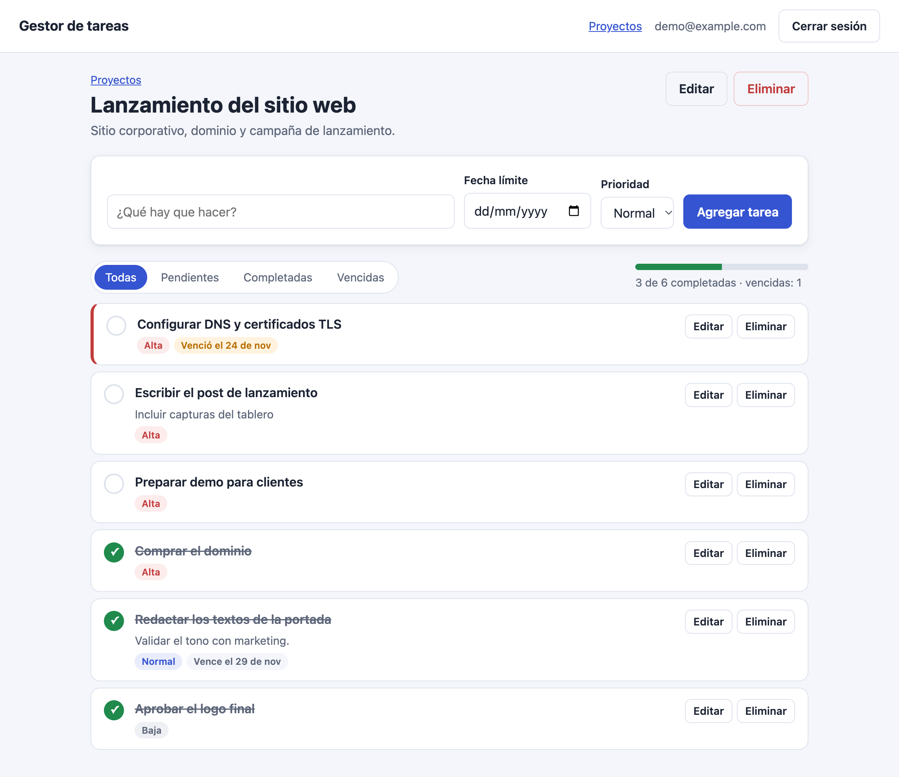

# Gestor de tareas en Ruby on Rails 8 con Hotwire: Turbo Streams, Turbo Frames y actualizaciones en tiempo real

[](https://github.com/KevinAndrey96/rails-hotwire-task-manager/actions/workflows/ci.yml)


[](LICENSE)

Aplicación de **gestión de proyectos y tareas** construida con **Ruby on Rails 8.1** y **Hotwire**, sin frameworks de JavaScript en el frontend ni Node.js en el build. Cada cambio en una tarea responde con **Turbo Streams**, la edición ocurre en línea dentro de **Turbo Frames** y las demás pestañas o usuarios que miran el mismo proyecto reciben **page refreshes con morphing de Turbo 8** a través de **Action Cable**. Usa el stack "sin Redis" de Rails 8: **SQLite con Solid Queue, Solid Cache y Solid Cable**, autenticación nativa de Rails 8, **importmap**, **Propshaft** y **Thruster**, empaquetado en una imagen Docker de producción.

El repositorio empezó en 2017 como el esqueleto vacío de un taller de Rails 5.1 ("taller1") y en 2026 se convirtió en una **aplicación de referencia de Rails 8 + Hotwire en español**. El commit original se conserva en el tag [`v0.1-rails-5.1-skeleton-2017`](https://github.com/KevinAndrey96/rails-hotwire-task-manager/tree/v0.1-rails-5.1-skeleton-2017).



## Características

- **Proyectos por usuario** con nombre único sin distinguir mayúsculas, garantizado también por un índice de expresión `lower(name)` en la base de datos.
- **Tareas priorizadas** (baja, normal, alta) con fecha límite opcional, notas y marca de completado. La prioridad es un `enum` validado y protegido por un `CHECK` en SQLite.
- **Orden útil**: primero las pendientes, luego las de mayor prioridad, después las que vencen antes y al final las que no tienen fecha.
- **Filtros** de todas, pendientes, completadas y vencidas, con contadores y barra de progreso.
- **Turbo Streams**: crear, editar, completar o eliminar una tarea redibuja el tablero, limpia el formulario y actualiza el mensaje flash sin recargar la página.
- **Turbo Frames**: la edición de una tarea se abre en línea dentro de su propia tarjeta.
- **Tiempo real**: `broadcasts_refreshes` envía un refresh por Action Cable y Turbo 8 aplica morphing conservando el scroll.
- **Autenticación de Rails 8** con sesiones en base de datos, recuperación de contraseña por correo y **registro propio**, ambos con `rate_limit`.
- **Interfaz en español** con `rails-i18n`, zona horaria de Bogotá y fechas localizadas.
- **Degradación elegante**: sin JavaScript, todos los formularios siguen funcionando con redirecciones HTML.

## Cómo funciona Hotwire en este proyecto

```
Usuario marca una tarea ─▶ PATCH /projects/:id/tasks/:id/toggle (Accept: turbo-stream)
                              │
                              ├─▶ respuesta turbo_stream: replace del tablero + update del flash
                              │
                              └─▶ after_commit: broadcasts_refreshes_to project
                                        │
                                        ▼
                                Solid Queue ─▶ Solid Cable ─▶ otras pestañas: <turbo-stream action="refresh">
                                                                   └─▶ Turbo 8 hace morphing de la página
```

La pestaña que originó el cambio ignora su propio refresh gracias al `request_id` de Turbo, así que solo recibe la respuesta del stream.

## Rutas

| Método | Ruta | Acción |
| :--- | :--- | :--- |
| `GET` | `/` | Listado de proyectos del usuario con progreso |
| `GET` `POST` | `/projects/new`, `/projects` | Crear proyecto |
| `GET` | `/projects/:id?filter=pending` | Tablero del proyecto con filtro |
| `PATCH` `DELETE` | `/projects/:id` | Editar o eliminar proyecto con sus tareas |
| `POST` | `/projects/:id/tasks` | Crear tarea (Turbo Stream) |
| `GET` `PATCH` | `/projects/:id/tasks/:id/edit`, `/projects/:id/tasks/:id` | Edición en línea (Turbo Frame) |
| `PATCH` | `/projects/:id/tasks/:id/toggle` | Completar o reabrir |
| `DELETE` | `/projects/:id/tasks/:id` | Eliminar tarea |
| `GET` `POST` | `/session/new`, `/registration/new`, `/passwords/new` | Autenticación, registro y recuperación |
| `GET` | `/up` | Health check |

## Seguridad

- Todo se consulta a través de `Current.user.projects`, así que el recurso de otro usuario responde **404**, nunca 403. Hay tests que lo verifican para proyectos y tareas.
- **Content Security Policy** estricta (`default-src 'self'`, `frame-ancestors 'none'`, `object-src 'none'`) con nonces de sesión para importmap y la barra de progreso de Turbo. La interfaz no usa estilos ni scripts en línea.
- Parámetros con `params.expect` de Rails 8: un payload mal formado responde 400 en lugar de lanzar una excepción.
- `rate_limit` en inicio de sesión, recuperación de contraseña y registro.
- Contraseñas de al menos 10 caracteres con `has_secure_password` y bcrypt.
- Sin secretos en el repositorio: no hay `master.key` ni credenciales cifradas. `SECRET_KEY_BASE`, el remitente de correo y la cuenta demo vienen de variables de entorno, y el historial de Git se purgó del `secret_key_base` que traía el esqueleto de 2017.
- SSL forzado por defecto en producción (`RAILS_FORCE_SSL=false` solo para contenedores locales en HTTP).
- Brakeman, bundler-audit e `importmap audit` en CI.

## Inicio rápido con Docker

```bash
cp .env.example .env
# Genera un secreto y pégalo en SECRET_KEY_BASE; opcionalmente define DEMO_PASSWORD
openssl rand -hex 64
docker compose up --build
```

Abre [http://localhost:3000](http://localhost:3000) y crea una cuenta. Si definiste `DEMO_PASSWORD`, el primer arranque crea `demo@example.com` con tres proyectos de ejemplo. La base SQLite vive en el volumen `storage` y Solid Queue corre dentro de Puma (`SOLID_QUEUE_IN_PUMA=true`).

Para comprobar una instancia en ejecución:

```bash
bin/smoke-test http://localhost:3000
```

## Desarrollo y pruebas

Requiere Ruby 3.4 (ver `.ruby-version`).

```bash
bundle install
bin/rails db:prepare
DEMO_PASSWORD=una-clave-larga bin/rails db:seed
bin/dev
```

```bash
bin/rails test        # modelos, controladores, Turbo Streams y broadcasts
bin/rubocop           # estilo rubocop-rails-omakase
bin/brakeman          # análisis estático de seguridad
bin/bundler-audit     # gemas con vulnerabilidades conocidas
```

Los tests cubren validaciones, scopes y orden de tareas, la unicidad en base de datos, el aislamiento entre usuarios, las respuestas `turbo_stream` con `assert_turbo_stream`, la edición dentro de frames y los broadcasts con `assert_turbo_stream_broadcasts`. El CI ejecuta seguridad, lint y tests, construye la imagen de producción, la arranca y corre la prueba de humo.

## Modernización 2026: antes y después

| Versión de 2017 | Versión de 2026 |
| :--- | :--- |
| Esqueleto vacío de Rails 5.1 sin modelos, rutas ni vistas | Aplicación completa de proyectos y tareas con Hotwire |
| Sprockets con Sass, CoffeeScript, Uglifier y Turbolinks 5 | Propshaft, importmap y Turbo 8 con Stimulus, sin paso de build de JavaScript |
| PostgreSQL local obligatorio para arrancar | SQLite con Solid Queue, Solid Cache y Solid Cable: cero servicios externos |
| `secret_key_base` escrito en `config/secrets.yml` | Secretos solo por entorno e historial de Git purgado |
| Sin autenticación | Autenticación de Rails 8, registro y recuperación de contraseña |
| Sin pruebas ni CI | Tests de modelos e integración, Brakeman, RuboCop y prueba de humo de Docker en GitHub Actions |
| Sin forma de desplegarse | Imagen Docker de producción con Thruster, health check y Solid Queue dentro de Puma |

## Estructura

```
├── app/
│   ├── controllers/   projects, tasks (Turbo Streams), registrations, sesiones y contraseñas
│   ├── models/        Project, Task, User, Session
│   └── views/
│       ├── projects/  listado, tablero y formularios
│       └── tasks/     _board, _task, edición en frame y respuestas .turbo_stream
├── config/locales/    es.yml
├── db/                migraciones, schema y seeds por entorno
├── bin/smoke-test     prueba de humo HTTP
├── docker-compose.yml
└── test/              modelos y controladores
```

## Autor

**Kevin Andrey Herrera Silva**, Senior Backend Engineer. [GitHub @KevinAndrey96](https://github.com/KevinAndrey96)

Licencia [MIT](LICENSE).
